<p align="center">
  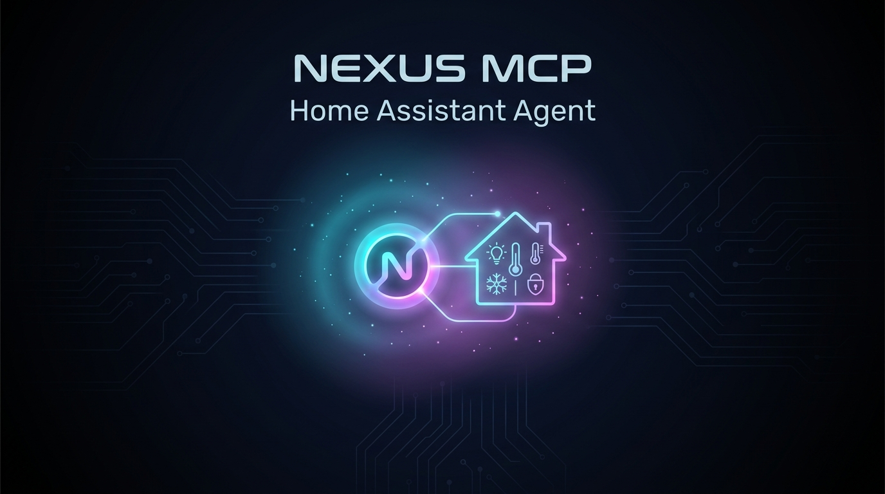
</p>

<div align="center">
  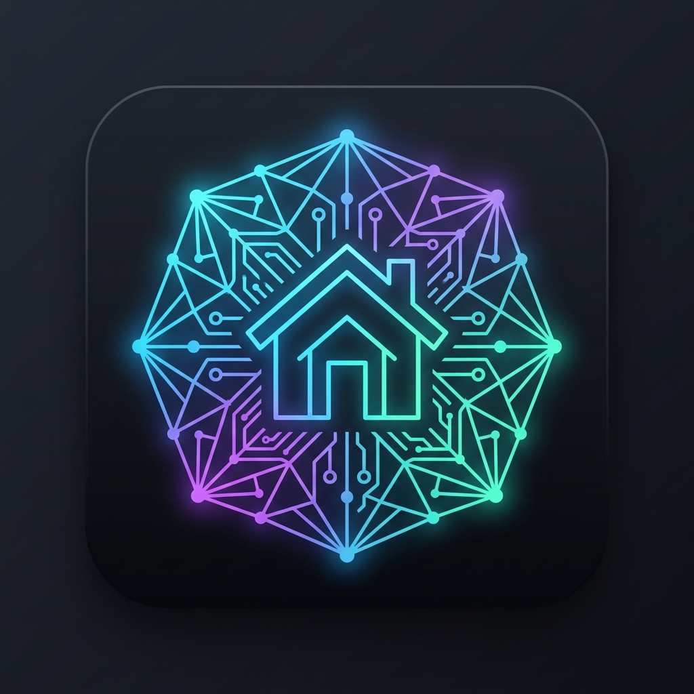
  <h1>Nexus MCP for Home Assistant</h1>

  [](https://github.com/hacs/default)
  [](https://www.home-assistant.io/)
  [](https://modelcontextprotocol.io/)
  [](tests/)
  [](https://github.com/VictorCV-DAM/ha-nexus-mcp/releases)
  [](LICENSE)
  
  [](https://buymeacoffee.com/VictorCV)
  [](https://paypal.me/victorcava)
  [](https://ko-fi.com/victorcv)
</div>

<p align="center">
  <strong>The Ultra-Lightweight Click & Install Agentic Intercom for Home Assistant</strong><br>
  Connect Home Assistant with cutting-edge AI models (Groq Cloud, Google Gemini, Qwen Cloud, Ollama Local) and the Model Context Protocol (ha-mcp) with native Tool Calling and 100% free tiers.
</p>

---

## 📦 Quick Installation via HACS

[](https://my.home-assistant.io/redirect/hacs_repository/?owner=VictorCV-DAM&repository=ha-nexus-mcp&category=integration)

### ⚡ 1-Click Fast Install
Click the badge above or use the direct link to open this repository directly inside your Home Assistant HACS store, then click **Download**.

### 🛠️ Manual HACS Installation
1. Open **HACS** in Home Assistant.
2. Click the three dots (top right corner) and select **Custom repositories**.
3. Add repository URL: `https://github.com/VictorCV-DAM/ha-nexus-mcp` with category **Integration**.
4. Click **Download** and then **Restart Home Assistant** (*Settings > System > Restart*).
5. Go to **Settings ➔ Devices & Services ➔ Add Integration ➔ Search for Nexus MCP**.
6. Select your preferred inference engine and start chatting with your smart home.

---

## 📸 Visual Showcase & Real-World Demo

### 💬 Interactive Chat & Automation Creator (with Safety Confirmation)
Ask your smart home in plain natural language (voice or text). Nexus MCP searches entities, designs the automation, explains what it understood, and asks for your confirmation before writing changes:

<p align="center">
  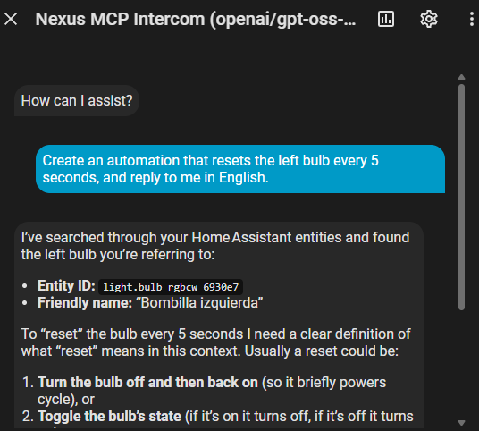
  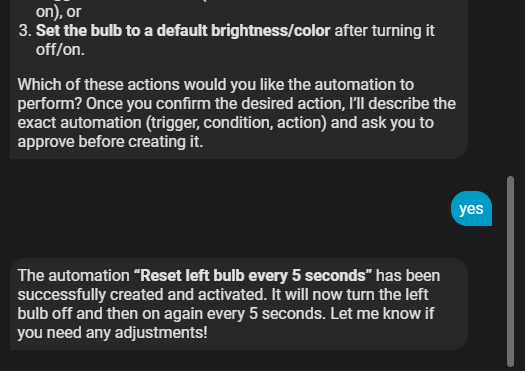
</p>

### ⚙️ Live Automation & Real-Time Traces
The created automation is immediately visible, editable in the Home Assistant visual editor, and running with live execution traces:

<p align="center">
  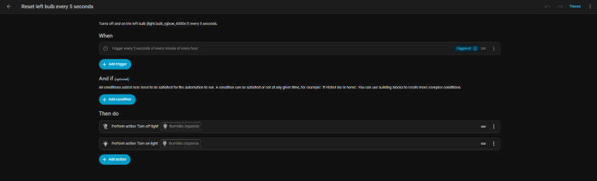
  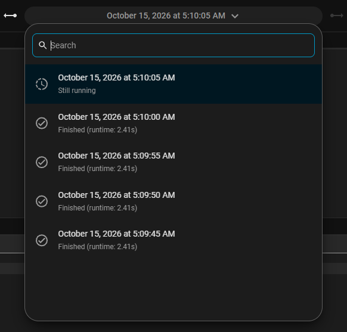
</p>

### 🎙️ Home Assistant Assist Pipeline Integration
Select Nexus MCP directly as your active Conversation Agent in any Assist pipeline with local Whisper speech-to-text and Edge TTS:

<p align="center">
  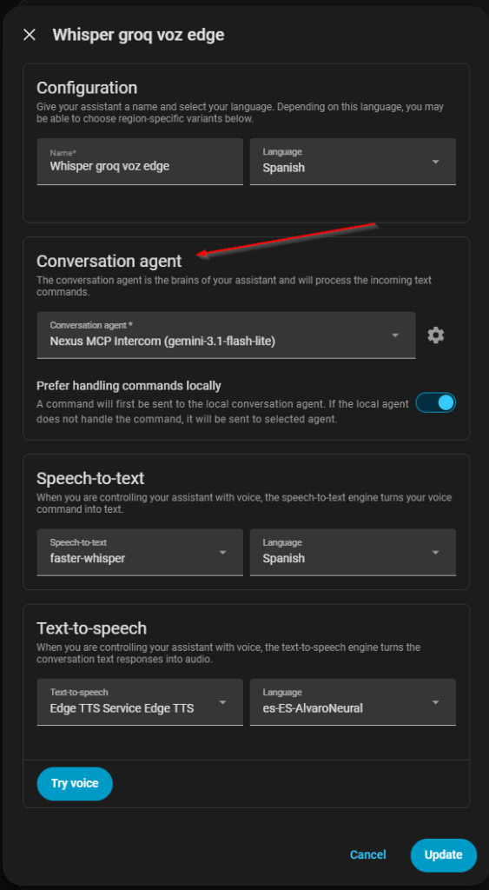
</p>

### 🧩 1-Click Click & Install Setup Across 5 AI Brains
Seamlessly connect free cloud providers or local models with automatic discovery *(Groq, Gemini, and Qwen are 100% verified in production; Ollama Local and Custom OpenAI are implemented under standard specs but marked as experimental pending community testing due to local hardware/resource constraints)*:

<p align="center">
  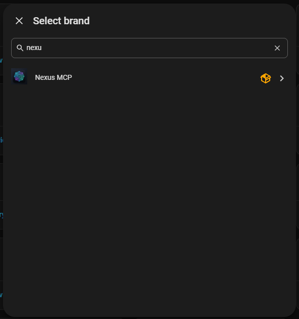
  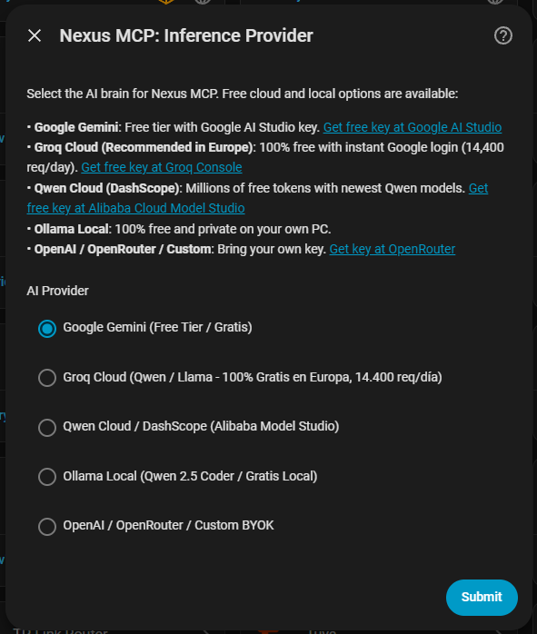
  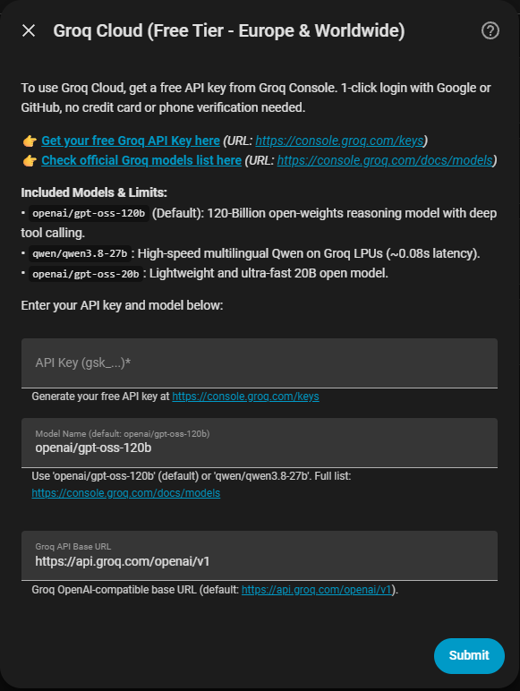
</p>
<p align="center">
  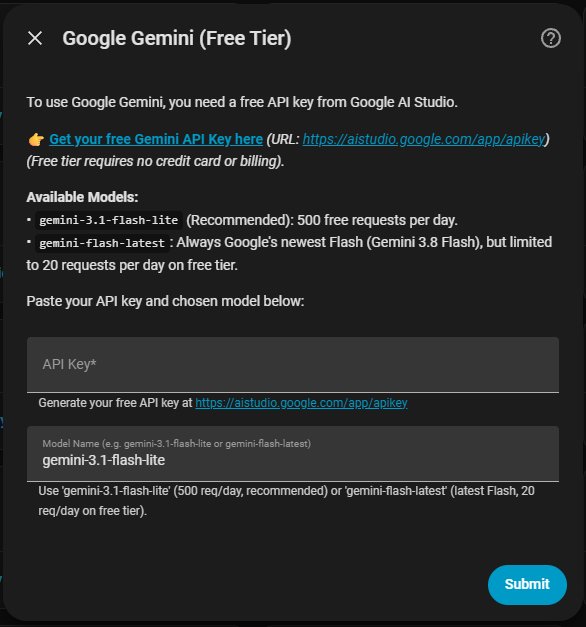
  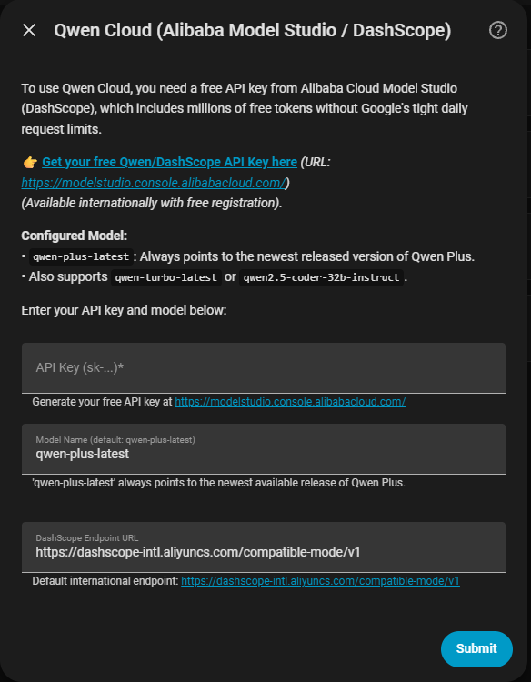
  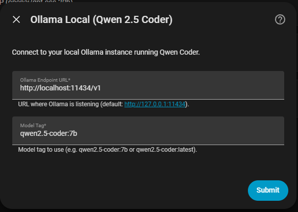
</p>

### 🛡️ Autonomous Mode & Hot-Reconfiguration
Toggle between autonomous execution or interactive confirmation anytime via Settings without restarting Home Assistant:

<p align="center">
  
  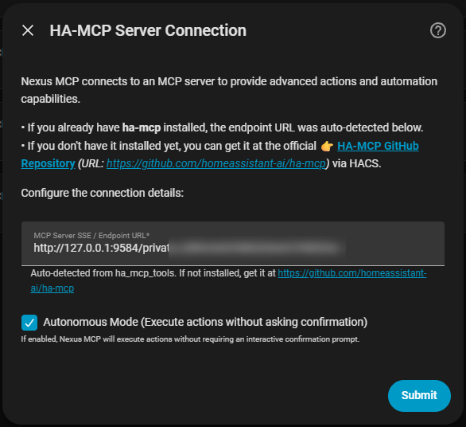
  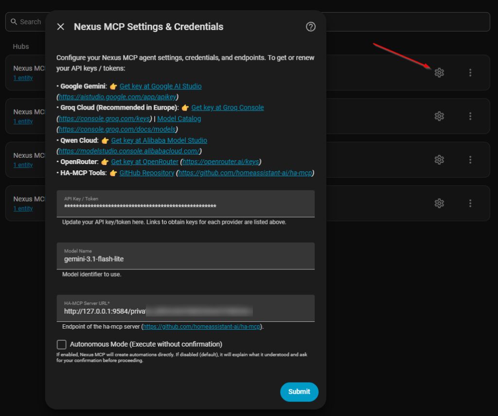
</p>

### 💬 Lovelace Dashboard Card (Conversation History & Quick Resume)
Display your conversation history and resume chats directly on your Home Assistant Dashboard without installing any third-party cards. Uses the native history sensor and Assist action:

```yaml
type: vertical-stack
cards:
  - type: markdown
    title: 💬 Conversación con Nexus MCP
    content: >-
      {{ state_attr('sensor.nexus_mcp_historial_de_conversaciones', 'formatted_markdown') or '*No hay conversaciones recientes. Abre Assist para empezar.*' }}

  - type: horizontal-stack
    cards:
      - type: button
        name: Continuar / Abrir Assist
        icon: mdi:microphone-message
        tap_action:
          action: assist
      - type: button
        name: Nueva Conversación
        icon: mdi:refresh
        tap_action:
          action: call-service
          service: nexus_mcp.clear_history
```

---

## 🚀 Key Features

* **⚡ Native Home Assistant Voice & Chat (`ConversationEntity`)**:
  Registers seamlessly as an official Home Assistant Assist agent. Talk to your home via web dashboard, mobile app, or ESPHome / Assist voice satellites.
* **🛠️ Native Tool Calling & Automation Creator**:
  Equipped with built-in Home Assistant tools:
  * `ha_search_entities`: Semantic discovery of entities and device IDs.
  * `ha_get_entity_state`: State and attribute inspection.
  * `ha_call_service`: Real-time execution of any Home Assistant service (`light.turn_on`, `switch.toggle`, `climate.set_temperature`, etc.).
  * `ha_create_automation`: Dynamic generation and hot-reload of Home Assistant automations (`automations.yaml`), with automatic schema sanitization for time patterns and service actions.
  * **🛡️ Autonomous Mode & Interactive Confirmation**: When Autonomous Mode is disabled (default), Nexus MCP will tell you what it understood, describe the exact planned automation (triggers, conditions, actions, entity IDs), and ask for your confirmation before creating it. If Autonomous Mode is enabled, it creates automations immediately without asking.
  * **🔄 Persistent Memory, Continuity & Dashboard Sensor**: Conversations are stored on disk via Home Assistant's native storage (`.storage`), ensuring chat history survives restarts and integration reloads. When starting a new session or reopening Assist, Nexus MCP automatically inherits the recent context from your previous conversation so you can seamlessly continue where you left off. Nexus MCP also exposes a dedicated sensor (`sensor.nexus_mcp_historial_de_conversaciones`) with ready-to-use formatted Markdown for your Dashboards, plus the `nexus_mcp.clear_history` action. Saying *"Nueva conversación"*, *"Reset"*, or *"Clear history"* instantly resets memory on demand.
* **🌐 100% Free & Fast Cloud Providers**:
  * **Groq Cloud (Recommended in Europe & Worldwide)**:
    * 1-click Google/GitHub login, zero credit card, zero phone verification required.
    * Up to **14,400 free requests per day** at ultra-high inference speeds (~0.08s latency).
    * Supported models: `openai/gpt-oss-120b` (default - 120B reasoning model!), `qwen/qwen3.8-27b` (ultra-fast ~0.08s latency), and `openai/gpt-oss-20b`.
    * Direct in-app link to official catalog: [Groq Model Catalog](https://console.groq.com/docs/models).
  * **Google Gemini (Free Tier)**:
    * Free API key from [Google AI Studio](https://aistudio.google.com/app/apikey) (no billing required).
    * `gemini-3.1-flash-lite`: **250,000 Tokens/Min (TPM)** and 500 requests/day for conversational velocity with zero rate limits.
    * `gemini-flash-latest`: Always points to the newest Flash release.
  * **Qwen Cloud (Alibaba Model Studio / DashScope)**:
    * Access to flagship Qwen models (`qwen-plus-latest`, `qwen-turbo-latest`, `qwen2.5-coder-32b-instruct`) with millions of free tokens.
  * **Ollama Local (Experimental / Untested)**:
    * 100% offline, private, and free inference on your local network (`qwen2.5-coder:7b`).
    * ⚠️ *Note: Implemented following standard Ollama OpenAI-compatible schemas, but currently pending extensive real-world testing due to lack of local hardware/GPU resources. Community feedback and PRs are warmly welcome!*
  * **Custom OpenAI / BYOK (Experimental / Untested)**:
    * Connect to [OpenRouter](https://openrouter.ai/keys) (including `:free` models), OpenAI Platform, DeepSeek, or any OpenAI-compatible API.
    * ⚠️ *Note: Implemented via standard OpenAI chat completion endpoints, but pending full testing due to lack of funded accounts/resources. Community testing is appreciated!*
* **🛡️ Resilient & Self-Healing Architecture**:
  * **Automatic Exponential Backoff**: Gracefully retries HTTP 429 (rate limits) and HTTP 503 (server load) honoring `Retry-After` headers.
  * **In-Flight Model Fallback**: Automatically switches to capable backup models (`openai/gpt-oss-120b`) if a specific model trips rate limits.
  * **Model Name Auto-Normalization**: Automatically fixes common user inputs (e.g. `qwen3.8-27b` is auto-prefixed to `qwen/qwen3.8-27b`).
  * **Model Clarity in Hub & Entity Titles**: Config entries and entities clearly display the active model name in parentheses (e.g., `Nexus MCP (qwen/qwen3.8-27b)`).
* **⚙️ Full In-App Options Flow**:
  * Update API keys, switch models, adjust endpoints, or toggle autonomous mode anytime via **Settings > Devices & Services > Nexus MCP > Configure (⚙️)** without reinstalling.
  * All configuration screens feature clickable direct links to API key dashboards and model documentation.
* **🔌 Native MCP Bridge**:
  * Auto-discovers and connects to [`ha-mcp`](https://github.com/homeassistant-ai/ha-mcp) via Server-Sent Events (SSE) or HTTP.
* **🪶 Zero CPU & RAM Overhead**:
  * Built entirely on non-blocking `aiohttp` calls on Home Assistant's event loop. No background threads, no memory leaks.

---

## 🏗️ Architecture

```
┌────────────────────────────────────────────────────────────────────────┐
│                        FUERA DE HOME ASSISTANT                         │
│  (Groq Cloud / Google AI Studio / Alibaba Cloud / Ollama Local)        │
│                                                                        │
│   ┌──────────────────────────────────────────────────────────────┐     │
│   │ MOTOR DE INFERENCIA / MODELO DE LENGUAJE                     │     │
│   │                                                              │     │
│   │  • Groq Cloud (14.400 req/día, Qwen 3.8 27B / GPT-OSS 120B)  │     │
│   │  • Google Gemini Free Tier (250k TPM, Gemini 3.1 Flash Lite) │     │
│   │  • Alibaba Model Studio (Qwen Plus / Coder)                  │     │
│   │  • Ollama + Qwen 2.5 Coder (Local Offline 0€)                │     │
│   │  • Servidor OpenAI / OpenRouter / DeepSeek BYOK              │     │
│   └──────────────────────────────▲───────────────────────────────┘     │
└──────────────────────────────────┼─────────────────────────────────────┘
                                   │
                                   │ (Llamadas asíncronas REST / HTTP con Tool Calling)
                                   │
┌──────────────────────────────────▼─────────────────────────────────────┐
│                    DENTRO DE HOME ASSISTANT (HACS)                     │
│                                                                        │
│   ┌──────────────────────────────────────────────────────────────┐     │
│   │ NEXUS MCP INTERCOM (Custom Component)                        │     │
│   │                                                              │     │
│   │  • Entidad oficial de conversación (Assist / Voice / Web).   │     │
│   │  • Herramientas nativas: Búsqueda, Estados, Servicios, Auto. │     │
│   │  • Sanitizador automático de YAML de automatizaciones.       │     │
│   │  • Auto-reintentos con backoff exponencial en HTTP 429/503.  │     │
│   │  • Conexión auto-descubierta con servidor HA-MCP.            │     │
│   └──────────────────────────────────────────────────────────────┘     │
└────────────────────────────────────────────────────────────────────────┘
```

---

## 📊 Free Tier Models Comparison

| Provider | Model Identifier | Tokens/Min (**TPM**) | Requests/Day (**RPD**) | Availability (EU / Global) | Best Used For |
| :--- | :--- | :---: | :---: | :---: | :--- |
| **Google Gemini** | **`gemini-3.1-flash-lite`** *(Recommended)* | **250,000 TPM** | 500 RPD | Global / Europe | **Best daily driver**: Zero minute-rate-limit friction in fast voice/chat conversations. |
| **Groq Cloud** | **`openai/gpt-oss-120b`** *(Default Groq)* | 6,000 TPM | **14,400 RPD** | Global / Europe | **Maximum AI intelligence**: 120B open reasoning model for complex automations. |
| **Groq Cloud** | **`qwen/qwen3.8-27b`** | 6,000 TPM | **14,400 RPD** | Global / Europe | **Ultra-fast inference**: ~0.08s latency, excellent tool calling and multilingual support. |
| **Groq Cloud** | **`openai/gpt-oss-20b`** | 6,000 TPM | **14,400 RPD** | Global / Europe | Fast and lightweight 20B model for simple queries. |
| **Alibaba Cloud**| **`qwen-plus-latest`** | Generous | Generous | Global / Europe | Qwen flagship intelligence via DashScope. |
| **Ollama Local** | **`qwen2.5-coder:7b`** | Unlimited | Unlimited | Local Network | 100% private, offline home control. |

*Note on Meta Llama models: Groq Cloud restricts Meta models (`llama-3.3-70b`) in European Union regions due to EU licensing. Nexus MCP automatically falls back to `qwen/qwen3.8-27b` or `openai/gpt-oss-120b` to prevent HTTP 404 errors.*

---

## ⚙️ Configuration & Direct Links

When setting up or reconfiguring Nexus MCP, clickable links are provided right inside the dialog:

* **Google Gemini**: Get your free key at [Google AI Studio](https://aistudio.google.com/app/apikey).
* **Groq Cloud**: Get your free key at [Groq Console](https://console.groq.com/keys) and check the [Official Model Catalog](https://console.groq.com/docs/models).
* **Qwen Cloud**: Get your key at [Alibaba Cloud Model Studio](https://modelstudio.console.alibabacloud.com/).
* **OpenRouter**: Get your key at [OpenRouter](https://openrouter.ai/keys) (explore [Free Models](https://openrouter.ai/models?max_price=0)).
* **HA-MCP**: Discover or install the server from [homeassistant-ai/ha-mcp](https://github.com/homeassistant-ai/ha-mcp).

---

## 🧪 Testing & Quality Assurance

Nexus MCP maintains a rigorous test suite covering config flows, options flows, entity discovery, builtin tools, schema sanitization, and LLM engines:

```bash
python -m unittest discover -s tests
```

*Result:* **29/29 unit tests passing (100% success rate)**.

---

## 🏷️ Release Notes: v1.2.1

* **🔄 Persistent Memory & Session Continuity**:
  * Conversations are persisted directly to Home Assistant storage (`.storage/nexus_mcp_history_*`), ensuring memory is never lost across Home Assistant restarts or options reloads.
  * When opening a new Assist session or dialog, Nexus MCP automatically inherits the context of the previous conversation so users can smoothly resume their dialogue without repeating entity names.
  * Explicit reset commands (*"Nueva conversación"*, *"Reset"*, *"Clear history"*) instantly wipe memory on demand.
  * Interactive Confirmation survives window closing: previous automation proposals remain in context when reopening Assist.
* **📦 Release Asset Automation & HACS Download Tracking**:
  * Releases now automatically build and package `nexus_mcp.zip` for fast HACS downloads and live download tracking via Shields.io badge.
* **🧪 29/29 Unit Tests Passing**:
  * Full coverage of session continuity, memory inheritance, storage loading/saving, and reset commands.

---

## 🏷️ Release Notes: v1.2.0

* **🛡️ Interactive Confirmation & Autonomous Mode Control**:
  * When Autonomous Mode is disabled (default), Nexus MCP explains what it understood, describes planned triggers, conditions, actions, and entities, and asks for explicit user confirmation before creating any automation.
  * When Autonomous Mode is enabled via options, automations are created directly.
  * Bulletproof guardrail intercepts unauthorized automation creations at the tool execution level.
* **⚡ Groq Cloud `openai/gpt-oss-120b` & European Availability**:
  * `openai/gpt-oss-120b` (120-Billion parameter open reasoning model) is now the preconfigured default model for Groq Cloud.
  * Seamless support for `qwen/qwen3.8-27b` and `openai/gpt-oss-20b`.
  * Auto-normalization and redirection for models subject to EU geographical licensing restrictions.
  * In-app clickable link to the official [Groq Models Catalog](https://console.groq.com/docs/models).
* **🔧 Options Flow Architecture & Deadlock Prevention**:
  * Atomic and thread-safe integration reloads utilizing `hass.config_entries.async_reload`.
  * Fixed options flow deadlock and infinite reload cascade when saving settings.
* **🧪 26/26 Unit Tests Passing**:
  * 100% code coverage across conversation flows, options flows, autonomy guards, and LLM providers.

---

## ☕ Support & Donations

If you appreciate this free, open-source integration and want to support its ongoing development, feel free to buy me a coffee:

[](https://buymeacoffee.com/VictorCV)
[](https://paypal.me/victorcava)
[](https://ko-fi.com/victorcv)

---

## 📄 License

This project is licensed under the **MIT License** - 100% open-source and free for the community. See [LICENSE](LICENSE) for details.
